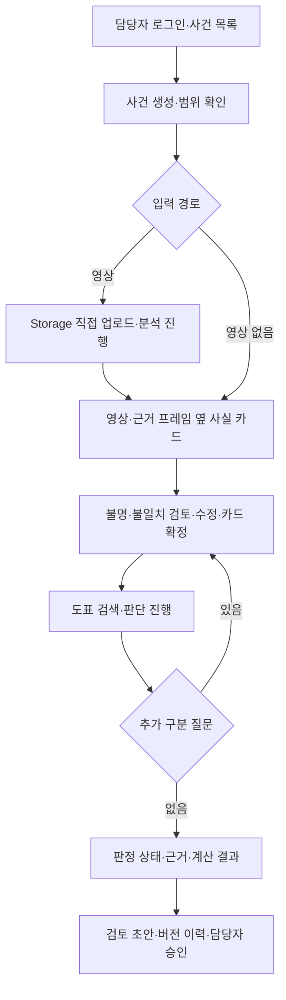

# ok-muncheol-fe

**옥문철 — AI 기반 자동차보험 보상 의사결정 지원 솔루션의 프론트엔드**

보상 담당자가 사고 영상·사실 카드를 확인하고, 도표·수정요소·계산 근거가 연결된 **과실비율 검토 초안**을
검토·승인하는 업무 화면이다. 신입 담당자는 같은 근거를 따라가며 학습하고, 심사 책임자는 판정 상태와 수정·승인 이력을 확인한다.

- 설계 원본: [AI 기반 자동차보험 보상 의사결정 지원 솔루션 설계 초안](https://app.notion.com/p/40eada0d3ad7816d91b0c73930ba2455) — 2026-11-05 확인
- 백엔드·계약 제안: [ok-muncheol-be](https://github.com/Ok-Muncheol/ok-muncheol-be)
- 역할별 작업·완료 기준: [TEAM.md](TEAM.md)

현재는 **문서 초기화 단계**다. 이 저장소에는 README.md와 TEAM.md만 있으며, 아래 화면·디렉터리·API·명령은
구현 계획이다. Next.js 앱, API 클라이언트, 목업, CI, 배포는 아직 없다.

## 범위와 사용자 흐름

| 단계 | 화면에서 지원할 기능 |
| --- | --- |
| 선행 MVP | 차대차 사건 접수, 영상 업로드 또는 사실 카드 직접 입력, 근거 프레임 확인·카드 수정/확정, 구분 질문, 도표·수정요소·과실비율 검토 초안, 검토·승인 이력 |
| 1차 확장 | 자차 견적·계약·지급 자료 추가, 약관 근거·보험금, 질의응답·what-if, 구상 청구 패키지 |
| 2차 확장 | 이륜차, 대물·대인·자손·자상, 양방향 정산 |



차대보행자·차대자전거·PM·3대 이상 연쇄 사고·단독 사고는 접수 단계에서 범위 밖으로 안내한다.
영상이 없는 사건에는 수동 사실 카드와 진술 근거 입력 경로를 제공한다. 보험금·구상·질의응답은 MVP 화면에
구현된 기능처럼 표시하지 않는다. 최종 판단은 담당자가 수행한다.

## 화면 원칙

- **사실을 고쳐서 판단한다.** 영상 요약문만 편집하는 대신 사실 카드의 필드·출처·증거·확인 상태를 보여 준다. 원래 모델값과 담당자 수정값을 구분한다.
- **불명은 정상 입력이다.** 핵심 필드 불명·저확신·근거 충돌을 확인 목록으로 제시한다. 평균 확신도 하나로 ‘판단 가능’을 표시하지 않는다.
- **과실과 금액은 BE 값으로 그린다.** FE가 비율·가감치·보험금을 계산하거나 카드 수정만으로 공식 결과를 바꾸지 않는다.
- **근거를 따라갈 수 있어야 한다.** 카드 칸에서 프레임 타임스탬프로, 도표·수정요소에서 적용판·원문 페이지로 이동한다.
- **작업 진행과 판정은 다르다.** ‘처리 완료’와 ‘초안 작성 가능’을 구분한다. 추가 확인·보류·실패를 서로 다른 상태로 보여 준다.
- **새로고침해도 복구한다.** 사건·작업 상태를 다시 조회한다. Realtime 알림만으로 현재 화면 상태를 결정하지 않는다.
- **초안·승인·가정을 구분한다.** 승인한 보고서 버전을 표시한다. 확장 what-if는 가정 결과로 나란히 보여 주고 공식 결과에 덮어쓰지 않는다.

## 기술 구성

| 구성 | 설계 또는 초기 제안 |
| --- | --- |
| 앱 | Next.js · React (설계 원본), App Router · TypeScript · Tailwind CSS는 lumi를 참고한 초기 제안 |
| 인증 | Supabase Auth, BE에서 토큰·담당 사건 권한 검증, DB·Storage RLS |
| 영상·파일 | Supabase Storage의 서명 URL로 직접 업로드·권한 있는 조회 |
| 진행 상태 | Supabase Realtime 변경 알림 + BE 상태 조회·복원 |
| 연동 계약 | BE 스키마·OpenAPI를 원천으로 FE 타입·비식별 견본 동기화 |
| 배포 | Vercel, FE·API를 한 프로젝트로 묶는 설계 목표의 연결 방식은 미정 |

공개 저장소 두 개와 배포 단위는 별개다. 두 저장소를 빌드 때 결합할지 통합 배포 저장소를 사용할지
인프라 작업에서 정하고, API 경로·인증·CORS·환경 변수와 함께 기록한다. 운영 URL은 아직 없다.

FE에는 공개용 Supabase URL·키 등 브라우저 노출을 전제로 한 값만 둔다. DB·LLM·VLM·Modal·Supabase 서버 비밀키는
BE에서 관리한다. 실제 변수명과 `.env.example`은 앱 부트스트랩에서 확정한다. 비공개 사건 데이터나
서명 URL을 문서·견본·추적 로그에 넣지 않는다.

## 화면·경로 제안

**아래 경로는 아직 존재하지 않는다.** 담당자용 데스크톱 업무 화면을 우선 설계하고 좁은 화면에서도
핵심 정보·확인·저장이 가능하도록 한다. lumi의 모바일 웰니스 화면 구성을 그대로 가져오지 않는다.

| 경로 제안 | 화면과 주요 동작 |
| --- | --- |
| `/login` | 담당자 로그인 |
| `/cases` | 담당 사건 목록, 진행·판정·승인 상태 |
| `/cases/new` | 사고 정보·당사자·입력 경로·범위 확인 |
| `/cases/[id]` | 진행 상태·질문·현재 버전 요약 |
| `/cases/[id]/facts` | 영상/키프레임 + 사실 카드, 수동 입력·근거·수정 이력·확정 |
| `/cases/[id]/reports/[version]` | 판정·근거·비율 검토 초안, 버전 비교·담당자 승인 |
| `/dev` | 개발 전용 비식별 견본·상태별 화면 미리보기 (운영 노출 차단 예정) |

```text
src/
  app/                  라우팅·레이아웃·로그인·사건 화면
  features/cases/       접수·목록·작업 상태
  features/facts/       영상·근거 프레임·필드 편집·확정
  features/evidence/    도표·수정요소·결정례·원문 보기
  features/reports/     질문·판정·보고서·승인·버전
  lib/api/              BE 계약 타입·클라이언트·오류·복원
  lib/supabase/         인증·업로드·Realtime
  fixtures/             비식별 계약 견본
  components/           공통 UI·상태·접근성
```

## BE 연동 계약 제안

아래는 [BE README](https://github.com/Ok-Muncheol/ok-muncheol-be#api-계약-제안)의 미구현 API 초안이다.
첫 계약 PR에서 스키마·인증·상태·오류·재개 방식을 확정하고 견본과 타입에 반영한다.

| 요청 제안 | 화면 동작 |
| --- | --- |
| `POST /cases` | 사건 생성, 범위 밖 사유 표시 |
| `POST /cases/{id}/uploads` | 서명 URL 발급 후 파일을 Storage에 직접 전송 |
| `POST /cases/{id}/analysis` | 업로드 완료 경로로 분석 접수, 작업 ID·상태 수신 |
| `GET /cases/{id}` | 진행·질문·버전 조회, 새로고침/재접속 복원 |
| `GET /cases/{id}/fact-card` | 필드별 값·모델 원값·근거·확인 상태 조회 |
| `PATCH /cases/{id}/fact-card` | 기대 카드 버전과 수정 전송, 충돌 시 최신값 재조회 |
| `POST /cases/{id}/fact-card/confirm` | 담당자 확인·확정 |
| `POST /cases/{id}/questions/{question_id}/answer` | 구분 질문 답변, 변경 카드 확인·확정 경로 연결 |
| `POST /cases/{id}/judgments` | 확정 카드로 판단 접수·재개 |
| `GET /cases/{id}/reports/{version}` | 버전별 보고서·근거 조회 |
| `POST /cases/{id}/reports/{version}/approve` | 표시 중인 버전에 대한 검토·승인 |

필드의 `value`, `source`, `model_confidence`, `verification_status`, `evidence_frame_ids`를 구분해 표시한다.
`needs_review`를 확인 대상으로 제시하고, 담당자 수정 후 `human_confirmed`가 돼도 모델 확신도를 100%로 바꾸지 않는다.
촬영 차량·가입자·도표 A/B 매핑은 별도 항목으로 확인한다. 영상 없는 사건에서는 프레임을 만들어 표시하지 않는다.

Realtime 연결이 끊겨도 업로드·분석·판단을 자동 중복 생성하지 않는다. 조회로 상태를 복원하고
서버가 허용하는 재시도 동작만 제공한다. 인증 만료·권한 부족·버전 충돌·작업 실패는 구분해 안내한다.

## 보고서 화면

| 항목 | 보여 줄 내용 |
| --- | --- |
| 판정 상태 | 초안 작성 가능 / 추가 확인 필요 / 판단 보류, 사유와 가능한 다음 동작 |
| 사고 사실 | 확정 카드·짧은 서술·근거 프레임, 담당자 수정 표시 |
| 도표 | 선택 도표와 차순위 후보, 선택/제외 이유, 도표 ID·적용판·원문 |
| 과실 계산 | 기본 A:B, 적용/미적용/불명 수정요소, 가감 근거·최종 비율 초안 |
| 확인 사항 | 남은 불명·반박 쟁점·참고 판례·담당자 질문 |
| 이력 | 카드·판단·보고서 버전, 검토자·승인자·시각·수정 사유 |

숫자와 근거가 부족한 사건을 그럴듯한 완성 보고서로 채우지 않는다. ‘추가 확인 필요’에는 질문을,
‘판단 보류’에는 사유를 보여 준다. 모든 산출물에 검토 초안임을 표시하고 담당자 승인 전 외부 전달을 제공하지 않는다.
1차 확장에서 손해액·보험금·약관·구상을 추가할 때도 추정/서류 접수/지급 완료를 구분한다.

## 개발 시작과 검증

현재 가능한 작업은 문서 확인과 계약 논의다.

```bash
git clone https://github.com/Ok-Muncheol/ok-muncheol-fe.git
cd ok-muncheol-fe
```

Node.js 버전·의존성·패키지 관리자·`.env.example`과 개발/검증 명령은 부트스트랩 PR에서 추가한다.
`npm run dev`, `npm run lint`, `npm run typecheck`, `npm test`, `npm run build`는 lumi를 참고한
도입 제안이며 **현재 package.json이 없어 실행할 수 없다**.

앱 구축 후에는 BE·GPU·모델 키 없이 비식별 견본으로 정상·불명·불일치·질문·보류·실패·버전 충돌을
검토할 수 있게 한다. 실제 연동에서는 로그인부터 영상/수동 접수·카드 확정·판단·근거 확인·승인·복원까지 검증한다.
세부 담당·검증 사례는 [TEAM.md](TEAM.md)에 있다.

## 협업

이슈 → `main`에서 `<타입>/#<번호>` 브랜치 → `main` PR → 검증 → squash merge를 기본 규칙으로 제안한다.
PR 제목은 `[feat/#12] 사실 카드 편집 화면`, 본문에는 `close #12`와 검증 결과·연결 BE PR을 적는다.
CI·브랜치 보호·ship 자동화는 아직 없다. BE 계약 변경 시 타입·견본·화면을 함께 맞춘다.

AI Hub 원본 영상·실제 사건·얼굴·번호판·위치정보·키를 저장소나 공개 미리보기에 넣지 않는다.
시연에는 권리를 확인한 안전한 영상을 사용한다. 데이터 처리 정책과 라이선스 확인 과제는 설계 원본 및 BE TEAM.md를 따른다.
