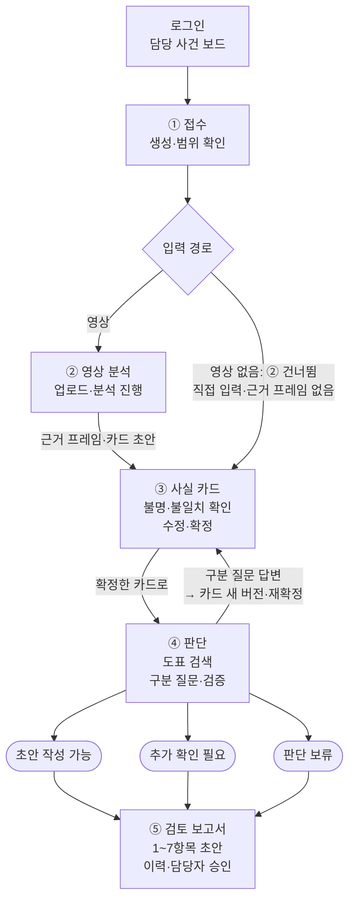

# ok-muncheol-fe

**OK문철 — AI 기반 자동차보험 보상 의사결정 지원 솔루션의 프론트엔드**

보상 담당자가 사고 영상·사실 카드를 확인하고, 도표·수정요소·계산 근거가 연결된 **과실비율 검토 초안**을
검토·승인하는 업무 화면이다. 신입 담당자는 같은 근거를 따라가며 학습하고, 심사 책임자는 판정 상태와 수정·승인 이력을 확인한다.

- 아키텍처 이미지: [v7 원본과 적용 기준](https://github.com/Ok-Muncheol/ok-muncheol-be#아키텍처-원본과-적용-기준)
- 백엔드·계약 제안: [ok-muncheol-be](https://github.com/Ok-Muncheol/ok-muncheol-be)
- 역할별 작업·완료 기준: [TEAM.md](TEAM.md)

현재는 **담당별 타입·컴포넌트 초안 단계**다. `src/features/`에 역할별 파일, `src/lib/api/`에 계약/클라이언트
인터페이스, `src/fixtures/`에 BE 생성 합성 양식이 있다. 일부 컴포넌트는 값을 표시하지만 완성 업무 화면은 아니다.
Next.js 앱은 라우트 골격과 담당 사건 보드·사건 상세(합성 견본 표시)까지 있고 Vercel 프로젝트 `ok-muncheol-fe`로 배포된다. 사실 카드·판단·보고서 화면과 인증·실제 요청·상태 저장은 아직 없다.
CI(lint·typecheck·test·build)와 ship 하네스는 있다([브랜치·PR 규칙](#브랜치pr-규칙)).

**개발 마감: 2026-11-13(금).** 11/12 기능 통합·11/13 최종 검수 목표다.
날짜별 합류 기준은 [TEAM.md](TEAM.md)와 [공통 일정](https://github.com/Ok-Muncheol/ok-muncheol-be/blob/main/docs/development-plan.md)을 따른다.

## 아키텍처 참고


로컬 `ok-muncheol/서비스아키텍처/accident-review-architecture-v7.png`를 2026-11-05 직접 확인했다.
그림은 확장 기능까지 포함한다. 선행 MVP에서는 사실 카드 확인→판단·검증→과실비율 보고서까지 구현하며,
손해액·보험금·약관·구상·질의응답은 후속 단계다.

그림의 ‘확신도 0.7 미만’은 제안값이다. FE는 임계값을 박아 확인 필드를 자체 결정하지 않고 BE가 반환한
필드별 확인 상태·질문을 표시한다. ‘9항목 보고서’도 MVP에서는 1~7번만 제공하며, 8~9번은 자차 확장에서 추가한다.
서류 추가에 따른 공식 새 버전 생성과, 점선으로 표시된 what-if 가정 실행을 화면에서도 구분한다.
그림과 다르게 적용하는 나머지 기준은 [BE 적용 기준](https://github.com/Ok-Muncheol/ok-muncheol-be#아키텍처-원본과-적용-기준)에 정리했다.

## 범위와 사용자 흐름

| 단계 | 화면에서 지원할 기능 |
| --- | --- |
| 선행 MVP | 차대차 사건 접수, 영상 업로드 또는 사실 카드 직접 입력, 근거 프레임 확인·카드 수정/확정, 구분 질문, 도표·수정요소·과실비율 검토 초안, 검토·승인 이력 |
| 1차 확장 | 자차 견적·계약·지급 자료 추가, 약관 근거·보험금, 질의응답·what-if, 구상 청구 패키지 |
| 2차 확장 | 이륜차, 대물·대인·자손·자상, 양방향 정산 |



①~⑤는 담당 사건 보드의 열 순서다(`src/lib/cases/stages.ts`의 `STAGES`). 이 그림은 화면 단계만 그린다.
API 경로·판단 그래프 단계와 판정 상태 3종이 어느 분기에서 나오는지는 BE [선행 MVP 처리 흐름](https://github.com/Ok-Muncheol/ok-muncheol-be#선행-mvp-처리-흐름)을 따른다.

차대보행자·차대자전거·PM·3대 이상 연쇄 사고·단독 사고는 접수 단계에서 범위 밖으로 안내한다.
영상이 없는 사건에는 수동 사실 카드와 진술 근거 입력 경로를 제공한다. 보험금·구상·질의응답은 MVP 화면에
구현된 기능처럼 표시하지 않는다. 최종 판단은 담당자가 수행한다.

## 화면 원칙

- **사실을 고쳐서 판단한다.** 영상 요약문만 편집하는 대신 사실 카드의 필드·출처·증거·확인 상태를 보여 준다. 원래 모델값과 담당자 수정값을 구분한다.
- **불명은 정상 입력이다.** 핵심 필드 불명·저확신·근거 충돌을 확인 목록으로 제시한다. 평균 확신도 하나로 ‘판단 가능’을 표시하지 않는다.
- **과실과 금액은 BE 값으로 그린다.** FE가 비율·가감치·보험금을 계산하거나 카드 수정만으로 공식 결과를 바꾸지 않는다.
- **근거를 따라갈 수 있어야 한다.** 카드 칸에서 프레임 타임스탬프로, 도표·수정요소에서 적용판·원문 페이지로 이동한다.
- **작업 진행과 판정은 다르다.** ‘처리 완료’와 ‘초안 작성 가능’을 구분한다. 추가 확인·보류·실패를 서로 다른 상태로 보여 준다.
- **새로고침해도 복구한다.** 사건·작업 상태를 다시 조회한다. Realtime 알림만으로 현재 화면 상태를 결정하지 않는다.
- **초안·승인·가정을 구분한다.** 승인한 보고서 버전을 표시한다. 확장 what-if는 가정 결과로 나란히 보여 주고 공식 결과에 덮어쓰지 않는다.

## 기술 구성

| 구성 | 설계 또는 초기 제안 |
| --- | --- |
| 앱 | Next.js 16 App Router · React 19 · TypeScript · Tailwind CSS v4, Node 24 · npm (세부 구성과 버전은 lumi를 따랐다) |
| 인증 | Supabase Auth, BE에서 토큰·담당 사건 권한 검증, DB·Storage RLS |
| 영상·파일 | Supabase Storage의 서명 URL로 직접 업로드·권한 있는 조회 |
| 진행 상태 | Supabase Realtime 변경 알림 + BE 상태 조회·복원 |
| 연동 계약 | BE 스키마·OpenAPI를 원천으로 FE 타입·비식별 견본 동기화 |
| 배포 | Vercel 프로젝트 `ok-muncheol-fe`에 연결(2026-11-06). `main` push마다 프로덕션 배포, PR 브랜치는 배포하지 않음(`vercel.json` `git.deploymentEnabled`). BE는 별도 Vercel 프로젝트 `ok-muncheol-be` |

저장소마다 Vercel 프로젝트를 따로 둔다 — 운영 주소는
FE `https://ok-muncheol-fe.vercel.app`, BE `https://ok-muncheol-be.vercel.app`이다(2026-11-09 확인).
오리진이 달라 FE는 `NEXT_PUBLIC_BACKEND_URL`(끝에 `/` 없이)로 BE를 부르고, BE는 `CORS_ALLOW_ORIGINS`에
FE 운영 주소를 둔다. BE CORS는 정확한 주소 목록만 허용한다.
PR 브랜치는 배포하지 않는다 — Hobby는 배포를 하루(24시간) 100번까지만 만들어, PR push마다 Preview를 만들면 한도가 차서
`main` 배포까지 막힌다. 머지 전 확인은 CI `check`(build 포함)와 로컬 `npm run dev`(`/dev` 미리보기)로 한다.

FE에는 공개용 Supabase URL·키 등 브라우저 노출을 전제로 한 값만 둔다. DB·LLM·VLM·Modal·Supabase 서버 비밀키는
BE에서 관리한다. 변수명은 `.env.example`에 있다(`NEXT_PUBLIC_BACKEND_URL`, `NEXT_PUBLIC_SUPABASE_URL`,
`NEXT_PUBLIC_SUPABASE_PUBLISHABLE_KEY` — 아직 읽는 코드는 없다). Vercel에는 세 값을 Config 유형으로
등록했다(바꾸면 다음 배포부터 반영). 비공개 사건 데이터나 서명 URL을 문서·견본·추적 로그에 넣지 않는다.

## 디자인 시스템: 청람

보상 담당자가 데스크톱에서 하루 종일 쓰는 업무 화면이라 **밝은 옥색 한 가지를 주요 색**으로 두고, 나머지는 회색 면·선·글자로만
구성한다. 상태는 색 이름이 아니라 뜻으로 고르는 여섯 톤으로 표시한다.
색 세트는 라이트·다크 둘이고 다크는 OS 설정(`prefers-color-scheme`)을 따른다. 글꼴은 본문 Noto Sans KR, 숫자·ID는 IBM Plex Mono다.
`/dev`에서 토큰과 컨트롤을 한 화면으로 본다.

토큰은 `src/app/globals.css`에 있다. 값은 `--ok-*` 변수에 두고 아래 Tailwind 클래스로 쓴다. 색 토큰은 `bg-` · `text-` · `border-` 어디에나 붙는다.

| 쓰임 | 클래스 |
| --- | --- |
| 화면 바탕 · 카드/표/머리글 · 표 머리줄과 비활성 입력 | `bg-page` · `bg-surface` · `bg-surface-muted` |
| 글자 · 보조 글자 · placeholder/빈 값 | `text-ink` · `text-ink-muted` · `text-ink-faint` |
| 구분선 · 입력과 보조 버튼 테두리 | `border-line` · `border-line-strong` |
| 입력 바탕 | `bg-control` |
| 주요 버튼 · 로고(밝은 옥색 면) | `bg-primary` · `text-on-primary` · `hover:bg-primary-hover` |
| 링크 · quiet 버튼 글자 · 현재 메뉴 밑줄(바탕 위 옥색 글자·선) | `text-primary-strong` · `border-primary-strong` |
| 선택 · quiet 버튼 hover | `bg-primary-soft` · `text-on-primary-soft` |
| 상태 톤(배지·안내 상자) | `bg-{info,success,warning,danger,model}-soft` + `text-on-{톤}-soft`, 점·테두리는 `bg-{톤}` · `border-{톤}` |
| 그림자 | `shadow-card`(카드) · `shadow-raised`(팝오버·드롭다운) |
| 반경 | `rounded-card` 12 · `rounded-control` 8(버튼·입력) · `rounded-badge` 6 (px) |
| 글자 크기 | `text-title` 22 · `text-heading` 17 · `text-body` 14 · `text-caption` 12 (px) |
| 글꼴 | 기본 `font-sans`, 사건 ID·금액·버전·비율은 `font-mono tabular-nums` |

| 톤 | 뜻 | 예 |
| --- | --- | --- |
| neutral | 아직 시작하지 않았거나 초안 | 대기 · 초안 |
| info | 진행 중이거나 다음 단계로 갈 수 있음 | 처리 중 · 초안 작성 가능 · 검토 초안 안내 |
| success | 끝났고 사람이 확인함 | 작업 완료 · 담당자 확인 · 승인 |
| warning | 사람이 봐야 다음으로 감 | 확인 대기 · 추가 확인 필요 · 판단 보류 |
| danger | 실패했거나 충돌함 | 작업 실패 · 버전 충돌 · 범위 밖 |
| model | 모델이 낸 값(담당자 값과 구분) | 모델 원값 · 확신도 |

공통 컨트롤은 `src/ui/controls.tsx`에 있다 — `Button`·`ButtonLink`(primary·secondary·quiet·danger, md·sm), `Badge`·`Notice`(톤),
`PageHeader`·`Card`·`DescriptionList`/`DescriptionRow`, `Field`·`Input`·`Select`·`Textarea`, `Table`·`Th`·`Td`, `StatStrip`/`Stat`·`Board`/`BoardColumn`(요약 수치 줄·단계 보드), `Spinner`·`Empty`.
앱 틀(머리글·주 메뉴)은 `src/ui/app-shell.tsx`이고 `/login`은 머리글 없이 그린다. 작업 진행·판정 상태는 `src/components/status-label.tsx`가 톤을 정한다.

- 밝은 옥색(`primary`)은 흰 바탕과 대비가 1.9:1뿐이라 면으로만 칠하고, 그 위 글자는 `on-primary`(짙은 옥색)다. 바탕 위 옥색 글자·선은 `primary-strong`을 쓴다 — `text-primary`·`border-primary`를 바탕 위에 쓰면 읽히지 않는다.
- info 톤은 주요 색과 따로 둔 파랑이다. 옥색은 success 초록과 색상이 가까워 info까지 옥색이면 ‘처리 중’과 ‘작업 완료’가 섞여 보인다.
- Tailwind 기본 팔레트(`bg-gray-100` 등)는 지웠다. 고정 색은 다크 모드에서 그대로 남기 때문이다. 영상 프레임 위 오버레이용 `white`·`black`만 남겼다.
- 두 세트 모두 WCAG AA 대비(글자 4.5:1, 표시선·컨트롤 테두리·상태 점 3:1)를 넘긴다. 새 토큰은 두 세트에 모두 넣고 같은 기준으로 확인한다.
- 키보드 초점은 `globals.css`가 모든 컨트롤에 2px 고리로 둔다(`:focus-visible`). 마우스 클릭에는 보이지 않는다.
- 다크를 보려면 브라우저 개발자 도구 Rendering 패널에서 `prefers-color-scheme: dark`를 켠다.

## 화면·경로 제안

**아래 라우트는 아직 대부분 골격이다.** `/cases`(담당 사건 보드)와 `/cases/[id]`(사건 상세)만 합성 견본(`src/fixtures/case-board.json`)을 그리고,
운영 배포에서는 비어 있다. 사실 카드·판단·보고서 화면은 제목만 있다. 컴포넌트 연결 계획은 `src/app/README.md`에 있다.
보상 담당자용 데스크톱 업무 화면을 우선 설계하고 좁은 화면에서도
핵심 정보·확인·저장이 가능하도록 한다. lumi의 모바일 웰니스 화면 구성을 그대로 가져오지 않는다.

| 경로 제안 | 화면과 주요 동작 |
| --- | --- |
| `/login` | 보상 담당자 로그인 |
| `/cases` | 담당 사건 목록, 진행·판정·승인 상태 |
| `/cases/new` | 사고 정보·당사자·입력 경로·범위 확인 |
| `/cases/[id]` | 진행 상태·질문·현재 버전 요약 |
| `/cases/[id]/facts` | 영상/키프레임 + 사실 카드, 수동 입력·근거·수정 이력·확정 |
| `/cases/[id]/judgment` | 도표 검색·판단 진행, 구분 질문 답변, 검증 3겹 결과 |
| `/cases/[id]/reports/[version]` | 판정·근거·비율 검토 초안, 버전 비교·담당자 승인 |
| `/dev` | 개발 전용 비식별 견본·상태별 화면 미리보기 (Vercel 운영 배포에서는 404 — `VERCEL_ENV=production`) |

```text
src/
  app/                  구준휘 통합: 루트 레이아웃·라우트 골격 (화면은 담당자가 채운다)
  features/cases/       정지원: 접수·영상/수동 입력
  features/facts/       정지원: 영상·사실 카드·담당자 확인
  features/judgment/    구준휘: 판단·검증 3겹·구분 질문
  features/qa/          구준휘: 근거 질의응답·what-if
  features/evidence/    김지은: 인정기준·결정례·약관/원문
  features/knowledge/   김지은: 개발용 코퍼스 검수 미리보기
  features/calculation/ 옥석현: 손해액·보험금
  features/claims/      옥석현: 구상 청구 패키지
  features/reports/     옥석현: 검토 초안·승인·버전
  lib/api/              구준휘 통합·전원: 수동 계약 타입·클라이언트 인터페이스
  lib/supabase/         정지원 구현·구준휘 통합: 인증/업로드/Realtime 계획
  fixtures/             BE 생성 합성 양식 (시연/평가 정답 아님)
  components/           공통 상태 표시 초안
```

## BE 연동 계약 제안

아래는 [BE README](https://github.com/Ok-Muncheol/ok-muncheol-be#api-계약-제안)의 미구현 API 초안이다.
첫 계약 PR에서 스키마·인증·상태·오류·재개 방식을 확정하고 견본과 타입에 반영한다.

| 요청 제안 | 화면 동작 |
| --- | --- |
| `POST /cases` | 사건 생성, 범위 밖 사유 표시 |
| `POST /cases/{id}/uploads` | 서명 URL 발급 후 파일을 Storage에 직접 전송 |
| `POST /cases/{id}/analysis` | 업로드 완료 경로로 분석 접수, 작업 ID·상태 수신 |
| `GET /cases/{id}` | 진행·질문·버전 조회, 새로고침/재접속 복원 |
| `GET /cases/{id}/fact-card` | 필드별 값·모델 원값·근거·확인 상태 조회 |
| `PATCH /cases/{id}/fact-card` | 기대 카드 버전과 수정 전송, 충돌 시 최신값 재조회 |
| `POST /cases/{id}/fact-card/confirm` | 담당자 확인·확정 |
| `POST /cases/{id}/questions/{question_id}/answer` | 구분 질문 답변, 변경 카드 확인·확정 경로 연결 |
| `POST /cases/{id}/judgments` | 확정 카드로 판단 접수·재개 |
| `GET /cases/{id}/reports/{version}` | 버전별 보고서·근거 조회 |
| `POST /cases/{id}/reports/{version}/approve` | 표시 중인 버전에 대한 검토·승인 |

필드의 `value`, `source`, `model_confidence`, `verification_status`, `evidence_frame_ids`를 구분해 표시한다.
`needs_review`를 확인 대상으로 제시하고, 담당자 수정 후 `human_confirmed`가 돼도 모델 확신도를 100%로 바꾸지 않는다.
촬영 차량·가입자·도표 A/B 매핑은 별도 항목으로 확인한다. 영상 없는 사건에서는 프레임을 만들어 표시하지 않는다.

Realtime 연결이 끊겨도 업로드·분석·판단을 자동 중복 생성하지 않는다. 조회로 상태를 복원하고
서버가 허용하는 재시도 동작만 제공한다. 인증 만료·권한 부족·버전 충돌·작업 실패는 구분해 안내한다.

## 보고서 화면

| 항목 | 보여 줄 내용 |
| --- | --- |
| 판정 상태 | 초안 작성 가능 / 추가 확인 필요 / 판단 보류, 사유와 가능한 다음 동작 |
| 사고 사실 | 확정 카드·짧은 서술·근거 프레임, 담당자 수정 표시 |
| 도표 | 선택 도표와 차순위 후보, 선택/제외 이유, 도표 ID·적용판·원문 |
| 과실 계산 | 기본 A:B, 적용/미적용/불명 수정요소, 가감 근거·최종 비율 초안 |
| 확인 사항 | 남은 불명·반박 쟁점·참고 판례·담당자 질문 |
| 이력 | 카드·판단·보고서 버전, 검토자·승인자·시각·수정 사유 |

숫자와 근거가 부족한 사건을 그럴듯한 완성 보고서로 채우지 않는다. ‘추가 확인 필요’에는 질문을,
‘판단 보류’에는 사유를 보여 준다. 모든 산출물에 검토 초안임을 표시하고 담당자 승인 전 외부 전달을 제공하지 않는다.
1차 확장에서 손해액·보험금·약관·구상을 추가할 때도 추정/서류 접수/지급 완료를 구분한다.

## 개발 시작과 검증

현재 가능한 작업은 역할별 타입·컴포넌트 본문 작성과 계약 검토다. `src/lib/api/client.ts`는 요청을 보내지 않는
인터페이스 초안이다. `src/fixtures/contracts.json`은 BE 생성 양식이며 실행 가능한 목업 시나리오가 아니다.

Node.js 24(`.nvmrc`)와 npm을 쓴다.

```bash
git clone https://github.com/Ok-Muncheol/ok-muncheol-fe.git
cd ok-muncheol-fe
npm ci
npm run dev   # http://localhost:3000
```

변경을 마치면 `npm run lint`, `npm run typecheck`, `npm test`, `npm run build`를 통과시킨다. CI `check`도 같은 명령을
같은 순서로 돌린다. `npm test`는 지금 ship 게이트·폴링 스크립트 테스트(`automation/test/`)이고, `src/**/*.test.mjs`를
만들면 함께 돈다. `.env.example`을 `.env`로 복사해 두지만 아직 읽는 코드는 없다.

Next.js 16은 API와 파일 규칙이 학습 데이터와 다를 수 있다. AI 에이전트 안에서 `npm run dev`를 돌리면 Next가
`AGENTS.md`에 설치된 버전의 문서(`node_modules/next/dist/docs/`) 안내 블록을 유지한다 — 그 블록은 고치지 않는다.

앱 구축 후에는 BE·GPU·모델 키 없이 비식별 견본으로 정상·불명·불일치·질문·보류·실패·버전 충돌을
검토할 수 있게 한다. 실제 연동에서는 로그인부터 영상/수동 접수·카드 확정·판단·근거 확인·승인·복원까지 검증한다.
세부 담당·검증 사례는 [TEAM.md](TEAM.md)에 있다.

## 브랜치·PR 규칙

BE 레포와 같은 규칙이다. feature → `main`으로 올린다 (`dev` 없음).

1. 이슈를 템플릿(기능 구현 · 기능 수정 · 오류 수정 · 리팩토링 · 문서 작업 · 기타 수정)으로 만든다.
2. `main`에서 `<타입>/#<이슈 번호>` 브랜치를 만든다. 예: `feat/#12`, `chore/#13`
3. `main`으로 PR을 올린다. 제목은 `[타입/#이슈 번호] 설명`(예: `[feat/#12] 사실 카드 편집 화면을 추가한다`)이고
   본문에 `close #이슈 번호`, 검증 결과, 연결 BE PR을 적는다. CI(`check`, `gitleaks`)를 통과해야 머지할 수 있고,
   squash merge한다.

`main`은 PR 필수(승인 0명), 필수 체크 `check`·`gitleaks`, 강제 푸시·삭제 금지로 보호한다.

위 1~3을 자동화한 것이 **ship 하네스**다. 코드 수정을 끝낸 뒤 Claude Code에서는 `/ship`, Codex에서는
`$ship`(또는 "ship"·"배포해줘")으로 부르면 검증(CI `check`와 같은 명령) → 이슈·브랜치 생성 → PR → CI 게이트 →
squash 머지 → main CI 확인 → 머지 커밋의 Vercel 프로덕션 배포 확인까지 진행한다. 절차 원본은 하네스 중립 명세
`automation/ship.md`·`automation/pipeline.md`이고, `.claude/commands/ship.md`와 `.agents/skills/ship/SKILL.md`는
각 하네스의 진입 어댑터다. 폴링·게이트 스크립트(`automation/bin/*.mjs`)는 Node 표준 라이브러리만 써서 bash·jq가
필요 없고, `automation/test/`가 회귀 검증한다. 처음 쓰는 PC에서 할 준비(도구 설치·로그인, Codex 설정,
Windows)는 [`automation/README.md`](automation/README.md)에 있다.

## 협업

BE 계약 변경 시 타입·견본·화면을 함께 맞추고, 양쪽 PR을 서로 연결한다.

AI Hub 원본 영상·실제 사건·얼굴·번호판·위치정보·키를 저장소나 공개 미리보기에 넣지 않는다.
시연에는 권리를 확인한 안전한 영상을 사용한다. 데이터 처리 정책과 라이선스 확인 과제는 [BE README 「협업·데이터 관리」](https://github.com/Ok-Muncheol/ok-muncheol-be#협업데이터-관리)와 BE TEAM.md를 따른다.
